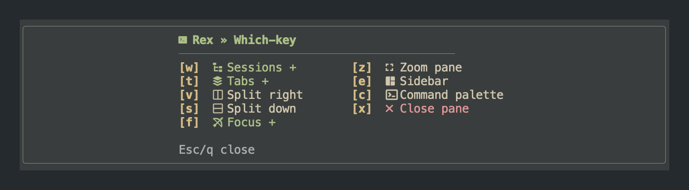

# rex-whichkey

A theme-aware which-key popup for [Rex](https://www.superlogical.com/rex/).
Define nested menus in Lua, then select actions by typing their displayed keys.



- Full-width top/bottom bars or left/right/center popup boxes.
- Icons, breadcrumbs, confirmation prompts, automatic sizing, and paging.
- Colors read from the terminal theme, including submenu and destructive-action colors.
- Nix packaging, an optional Home Manager module, and a development shell.

Tested with Rex Beta 0.1.0 build 1101 on macOS. Linux packages and shells are
exposed, but the popup has not been visually verified on a Linux Rex client.
Rex itself is installed separately; this repository does not distribute it.
Flake outputs cover `aarch64-darwin`, `aarch64-linux`, and `x86_64-linux`.
The pinned unstable Nixpkgs no longer supports Intel macOS.

## Install with Home Manager

Add the input to your configuration's flake:

```nix
inputs.rex-whichkey = {
  url = "github:curtbushko/rex-whichkey";
  inputs.nixpkgs.follows = "nixpkgs";
};
```

Import `inputs.rex-whichkey.homeManagerModules.default` in the modules used to
construct your Home Manager configuration, then enable:

```nix
programs.rex-whichkey = {
  enable = true;
  # Optional when `rex` is already in the Rex server's PATH:
  rexCli = "/Applications/Rex Beta.app/Contents/Helpers/Rex Server.app/Contents/MacOS/rex";
};
```

The module installs only `rex/whichkey/plugin.lua` under your XDG config
directory. **It does not overwrite or generate your Rex `init.lua`.**
It also does not install Rex, enable Remote Control, or select the app's theme.
Enable Rex's Remote Control so the helper can request menu data and dispatch actions.

Add this to your existing Rex `init.lua`:

```lua
local config_home = os.getenv("XDG_CONFIG_HOME") or (os.getenv("HOME") .. "/.config")
local whichkey = dofile(config_home .. "/rex/whichkey/plugin.lua")
whichkey.setup({ position = "center" })

rex.bind("alt+space", "whichkey")
-- Optional prefix binding:
rex.bind("ctrl+b>space", "whichkey")
```

Apply your Home Manager configuration and run `rex config reload`. Keep your
existing Rex bindings/actions; only add the plugin setup once.

### Private repository or local development

Until this repository is public, use an authenticated Git input instead:

```nix
url = "git+ssh://git@github.com/curtbushko/rex-whichkey?ref=main";
```

SSH access must be available to the process fetching the input. Never put tokens
in flake URLs. For an unpublished checkout, temporarily use
`url = "path:/absolute/path/to/rex-whichkey";`. Commit and push the plugin before
switching a consumer to a remote input. Consumers pin its revision in their own
`flake.lock`; update with `nix flake update rex-whichkey`.

## Configure menus

With no `spec`, setup uses the standard Sessions, Tabs, Split, Focus, Zoom,
Sidebar, Command Palette, and confirmed Close menus.

To supply your own entries, replace the same setup call with:

```lua
whichkey.setup({
  position = "center",
  spec = {
    { "p", group = "Panes", icon = "" },
    { "pz", "pane.zoom", desc = "Zoom pane", icon = "󰊓" },
    { "px", "pane.close", desc = "Close pane", icon = "󰅖", confirm = true },
    { "ps", group = "Split", icon = "󰙅" },
    { "psr", "pane.split", desc = "Right", icon = "", args = { direction = "right" } },
    { "psd", "pane.split", desc = "Down", icon = "", args = { direction = "down" } },
  },
})
```

Press **p → s → r** to split right. Add more rows to `spec` to add entries.
Supplying `spec` **replaces**, rather than appends to, the standard menus.
Use a Nerd Font for the example icons.

Each entry has:

| Field | Meaning |
| --- | --- |
| `[1]` | Full key sequence, such as `"psr"` |
| `[2]` | Rex action name, or a Lua callback `(ctx, args)` |
| `group` | Submenu label; group entries have no action |
| `desc` | Action label |
| `icon` | Optional glyph; falls back to the parent group's icon |
| `args` | Named arguments passed to the action/callback |
| `confirm` | Require `y` before executing |
| `cond` | Boolean or function; false omits the entry |
| `hidden` | Hide the hint without disabling its key |

`desc`, `group`, and `icon` may also be functions returning strings. Metadata
functions run in Rex; keep them fast and side-effect-free. Callbacks run only in
Rex, after focus returns to the originating pane. Neither callbacks nor action
arguments are exported to the renderer.

Nested tables inherit attributes, not key prefixes. Always write the full key:

```lua
{
  confirm = true,
  { "px", "pane.close", desc = "Close pane", icon = "󰅖" },
  { "tx", "client.tab.close", desc = "Close tab", icon = "󰅖" },
}
```

Optional root metadata: `title`, `icon`, and
`icons = { breadcrumb = "»", group = "+" }`.
This is a terminal-oriented subset of which-key.nvim's spec, not a Neovim plugin;
Neovim modes, `<cmd>` strings, proxies, and highlight/icon lookup tables are not supported.

### Position and navigation

`position` is the only placement option exposed by setup:

- `top`, `bottom`: full-width bars.
- `left`, `right`, `center`: framed popups. Center is the default.

Width, spacing, height limits, backends, and theme fallbacks are internal.
Escape/Backspace goes up a level; Escape at the root closes. `q` closes unless
mapped in that menu. Tab cycles pages. Close actions require `y`; another key
cancels confirmation. `<Space>` and `<lt>` are supported key notations.

Override placement for one invocation with `position=right` in a `rex do whichkey`
command, or `rex.bind("alt+w", "whichkey", { position = "right" })`.

## Theme and rendering

At each opening the plugin queries OSC 10/11 for foreground/background and
OSC 4 for yellow keys (3), gray borders/help (8), red close/confirmation items
(1), and cyan-slot submenus (6). The theme determines each slot's actual hue.
The popup background blends 12% foreground into the terminal background so the
surface is distinct on dark and light themes. Semantic colors are adjusted for
contrast. Missing replies use internal fallbacks after a 50 ms total query budget.
No Stylix, Ghostty configuration, or theme file is required.

Set `NO_COLOR=1` for uncolored output or `REX_WHICHKEY_ASCII=1` for plain borders
and no Nerd Font icons. These must reach the Rex server's environment, not just
a separate terminal shell. Theme changes are picked up at the next opening.

Build 1101 clips offset floating rectangles inconsistently. The plugin currently
uses a full-window backing layer and paints only its menu region. Unpainted
cells show the underlying pane in tested clients, but the layer is modal and
outside-menu mouse behavior is not guaranteed. Rounded borders leave corner
cells unpainted; this is not pixel-rounded native clipping. The alternative
native geometry backend remains internal until a fixed Rex client is verified.

## Nix package without the module

`packages.<system>.default` is the helper derivation; its `.plugin` attribute is
the packaged Lua entry point. `packages.<system>.plugin` exposes that file directly.
For a custom CLI location:

```nix
let
  whichkey = inputs.rex-whichkey.lib.mkPackage {
    inherit pkgs;
    rexCli = "/absolute/path/to/rex";
  };
in {
  xdg.configFile."rex/init.lua".text = ''
    local whichkey = dofile("${whichkey.plugin}")
    whichkey.setup({ position = "center" })
    rex.bind("alt+space", "whichkey")
  '';
}
```

Merge those Lua lines into your existing init generator if it is already managed.
The helper is an internal program; running `nix run` is not how to open the menu.
Rex Lua loads the entry point, while the packaged Bash/Lua 5.4 helper owns terminal
input and rendering. The Rex-facing code remains compatible with embedded Lua 5.1.

## Development

```sh
nix develop
task --list
task test
task check
```

`task fmt` formats sources. `task build` builds both package outputs.

Preview the current checkout directly in your terminal (inside `nix develop`):

```sh
task test:manual
task test:manual POSITION=center
```

This builds the helper and opens an interactive preview of the default menu.
Navigation, pagination, and confirmations work; selecting an action only closes
it. No Rex server or installed configuration is needed. Escape/q closes the
preview and restores your terminal. This tests terminal rendering, not Rex's
floating-layer integration.

Lua-specific commands inside the dev shell:

```sh
task lint-lua       # Luacheck plus Lua 5.1 syntax checks
task check-lua51    # Only the Rex-facing syntax compatibility checks
task fmt-lua        # Format Lua and .luacheckrc with StyLua
task fmt-check-lua  # Check Lua formatting without writing files
task lint          # Lua and Bash linting
```

`.luacheckrc` uses Lua 5.4 for the frontend/tests and Lua 5.1 standards for
Rex-facing modules/examples. Rex globals and test mocks are allowed only where
needed. Lua 5.1's `luac -p` additionally checks actual parser compatibility.
`LUA51_LUAC` points to that compiler in the dev shell, while `lua` stays on 5.4.
`nix flake check` builds the package, runs its unit/integration tests, and checks
the Home Manager module's enable/disable behavior and CLI wiring. It also runs
Luacheck and Lua 5.1 syntax checks. It does not
activate a system configuration or require a running Rex client.

The dev shell supplies Lua with `luautf8`/`dkjson`, Task, Alejandra, StyLua,
Luacheck, the Lua 5.1 compiler, ShellCheck, shfmt, and runtime command-line tools. New files must be visible to
Git for flake builds (`git add -N path` is enough during development).

Code is in `lua/whichkey/`; packaging and the Home Manager module are in `nix/`.
See [implementation notes](docs/implementation.md) for architecture and testing.

## License

The project's root [LICENSE](LICENSE) is MIT. The upstream-derived which-key.nvim
layout portions retain their Apache-2.0 license and notices in
[lua/whichkey/LICENSE](lua/whichkey/LICENSE).
